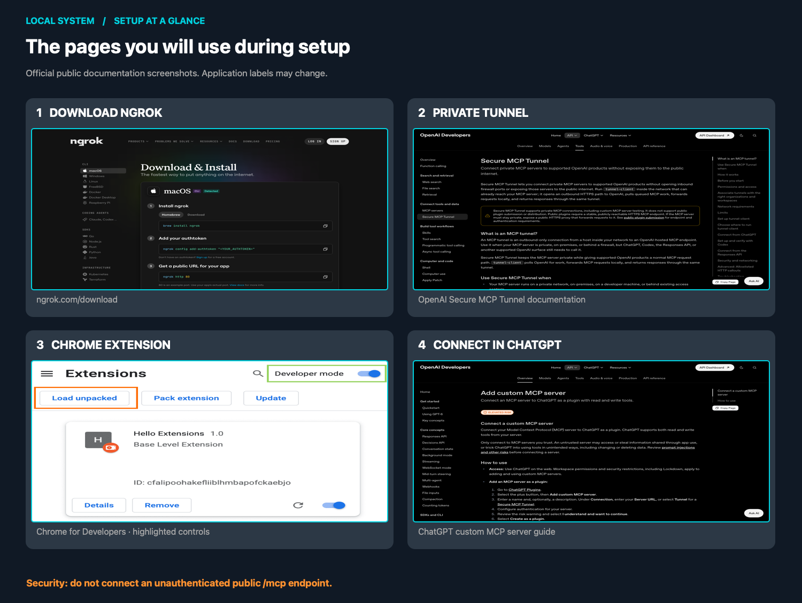

<!-- BRAND SLOT: Replace the icon below with the finalized Local System SVG / wordmark in P2. -->
<div align="center">
  
  <h1>Local System</h1>
  <p><strong>Your computer, inside your ChatGPT workflow.</strong></p>
  <p>Run local tools, navigate project files, review changes, and open generated artifacts without leaving ChatGPT.</p>
  <p>
    <a href="#get-started">Get started</a> ·
    <a href="docs/INSTALL-NGROK.md">ngrok setup</a> ·
    <a href="docs/INSTALL-SECURE-TUNNEL.md">Private tunnel setup</a> ·
    <a href="docs/SECURITY.md">Security model</a>
  </p>
</div>

> **Early open-source release.** Local System is a developer tool that runs with the privileges of your computer account. It is **not** a sandbox. Start with a test project, review tool requests, and don't expose the MCP server on a public unauthenticated endpoint.

<div align="center">
  
  <br />
  <sub>Real public documentation screenshots, including Google’s highlighted Chrome setup UI. The current app screens may differ; follow the linked guides for up-to-date steps.</sub>
</div>

## What makes Local System different?

This isn't simply a shell exposed to an AI model. It combines a **small, inspectable MCP tool surface** with a **ChatGPT-native file workspace**. The emphasis is on keeping your coding conversation and your local project in the same place.

<table>
<tr><td width="50%"><strong>🗂️ Your project beside the chat</strong><br/>A Chrome side-panel workspace with a file tree, tabs, searching, in-place editing, project switching, and change visibility.</td><td><strong>🔎 File references you can open</strong><br/>Resolve file paths mentioned in ChatGPT against the selected workspace, then preview supported files without hunting through Finder.</td></tr>
<tr><td><strong>📝 Annotations in context</strong><br/>Mark up file selections and rendered Markdown; attach timestamped notes to videos and copy structured feedback back into the conversation.</td><td><strong>🎞️ More than code previews</strong><br/>Rendered Markdown, sandboxed HTML, images, PDFs, and locally streamed video in the same workspace. Supported formats vary by context.</td></tr>
<tr><td><strong>⏳ Tasks that survive long runs</strong><br/>Run commands, monitor managed tasks, and keep conversation-scoped progress, todos, and runtime checkpoints available across tool calls.</td><td><strong>🛡️ Human approval, local control</strong><br/>Explicit confirmation for classified destructive operations by default, restricted file roots, audit events, and a small fixed set of 11 MCP tools.</td></tr>
</table>

Those are the project's design priorities—not a claim that competing tools can't implement similar features. The [extension guide](extensions/local-system/README.md) explains the workspace in more detail.

<!-- DEMO SLOT (P1): Add a 45–90 second GIF/video recorded in a sanitized demo project here. -->

## Get started

You need **Node.js 20+**, npm, a supported ChatGPT account/workspace that can add a custom MCP server, and **Chrome** if you want the file-workspace extension. The underlying bridge works without the extension. Some setup and features are platform-specific.

```bash
git clone https://github.com/Veer376/chatgpt-local-system.git
cd chatgpt-local-system
npm ci
```

**Choose your connection method:**

| Path | Who it's for | State |
| --- | --- | --- |
| **[ngrok / public HTTPS](docs/INSTALL-NGROK.md)** | Developers who already have a ChatGPT-compatible OAuth protection layer or secure gateway | **Advanced / manual only.** Not yet a one-click connection. |
| **[OpenAI Secure MCP Tunnel](docs/INSTALL-SECURE-TUNNEL.md)** | Developers who want a currently supported private connection with no public MCP URL | **Working setup path.** Requires OpenAI Platform tunnel configuration. |

**Why isn't ngrok one command?** An unprotected `ngrok http 8765` would make local command and file operations accessible on the internet. ChatGPT's standard custom-MCP flow doesn't let an ordinary user simply paste a custom bearer token to solve that. Our goal is **install → sign in → approve device → connect**, but hosted OAuth/device pairing is **not implemented yet**. See the [ngrok guide](docs/INSTALL-NGROK.md) for exactly what's available.

### Install the optional Chrome extension

1. Open **`chrome://extensions`** in Chrome.
2. Turn on **Developer mode** and select **Load unpacked**.
3. Select **`chatgpt-local-system/extensions/local-system`**.
4. Copy the extension ID from the installed extension card and set `LOCAL_EXTENSION_ORIGIN=chrome-extension://YOUR_EXTENSION_ID` in the bridge's configuration. Restart the bridge after changing it.
5. Open [ChatGPT](https://chatgpt.com/) and click the Local System toolbar action to access the workspace.


[Chrome's official instructions for loading unpacked extensions](https://developer.chrome.com/docs/extensions/get-started/tutorial/hello-world#load-unpacked)

**First safe test:** Open a disposable/sample project. In ChatGPT, select the Local System tool and request *“Show me the current workspace and list the top-level files. Don't modify anything.”* Confirm that its path and tools match the project you authorized.

## How the pieces fit together

```text
ChatGPT + Local System MCP plugin
          │
          ├── OpenAI Secure MCP Tunnel (private, recommended today)
          │                         OR
          └── HTTPS + OAuth gateway (ngrok, advanced/under development)
                                      │
                                  Local Node bridge
                                  127.0.0.1:8765
                                    /mcp
                                      │
                            Authorized local computer
                           Files · Commands · Tasks · Skills

Chrome extension ── authenticated loopback session ── file workspace
```

Local System exposes a fixed **11-tool MCP contract**, including `bridge_context`, `workspace`, `execute_command`, `apply_patch`, `display`, `view_image`, `manage_task`, `request_user_input`, `write_todos`, `runtime_memory`, and `discover_skills`.

The Chrome extension is optional, but its file tree, previews, annotations, and local sidebar depend on the running local bridge. The terminal bridge is **not** a desktop app or a hosted account service.

## Safety and limitations

- **High authority:** shell commands execute with the privileges of the local OS user. Workspace path limits are **not an operating-system sandbox**.
- **Approval defaults:** destructive actions classified by the application require approval unless a user deliberately opts out; this is not a guarantee that every shell side effect is detected.
- **Network:** keep `/mcp` private unless you have a verified ChatGPT-compatible OAuth gateway. Never tunnel `/local-ui/*`, `/local-file/*`, or `/local-image/*` to the public internet.
- **Extension:** installed manually using Chrome Developer mode. It depends on ChatGPT's evolving web interface, so UI updates can require fixes.
- **Account access:** custom MCP connection availability and UI vary by ChatGPT plan and workspace policy.
- **Privacy:** connected tool calls can transmit file names/content, command outputs, and other selected data to ChatGPT. Do not connect folders containing secrets you don't intend to share.

Read [Security](docs/SECURITY.md) and [operational guidance](docs/OPERATIONS.md) before broadening access.

<details>
<summary><strong>Troubleshooting and useful links</strong></summary>

| Issue | Check |
| --- | --- |
| ChatGPT can't find the MCP tools | Keep the bridge and tunnel running; confirm `http://127.0.0.1:8765/readyz` returns HTTP 200. |
| Extension shows no files | Confirm the server is running and `LOCAL_EXTENSION_ORIGIN` matches the current Chrome extension ID. |
| Tunnel is missing | Confirm Platform tunnel permissions and association with the correct ChatGPT workspace. |
| Browser UI changed | Reload the unpacked extension and refresh ChatGPT. |
| macOS/Linux service setup | See [operations](docs/OPERATIONS.md). |
| Security question | See [security model](docs/SECURITY.md). |

**Official references:** [ChatGPT custom MCP setup](https://developers.openai.com/api/docs/guides/custom-mcp-server) · [Secure MCP Tunnel](https://developers.openai.com/api/docs/guides/secure-mcp-tunnels) · [ngrok downloads](https://ngrok.com/download) · [Chrome unpacked extensions](https://developer.chrome.com/docs/extensions/get-started/tutorial/hello-world#load-unpacked)

</details>

## Contribute

Issues, test cases, documentation fixes, and focused pull requests are welcome. The first priorities are a smooth authenticated ngrok onboarding flow, more reliable browser integration, clearer cross-platform installation, and the next version of the visual identity. See the [technical reference](docs/TECHNICAL_REFERENCE.md) for deeper internals.

**License:** [MIT](LICENSE). Local System is an independent open-source project, not an official OpenAI or ngrok product.
