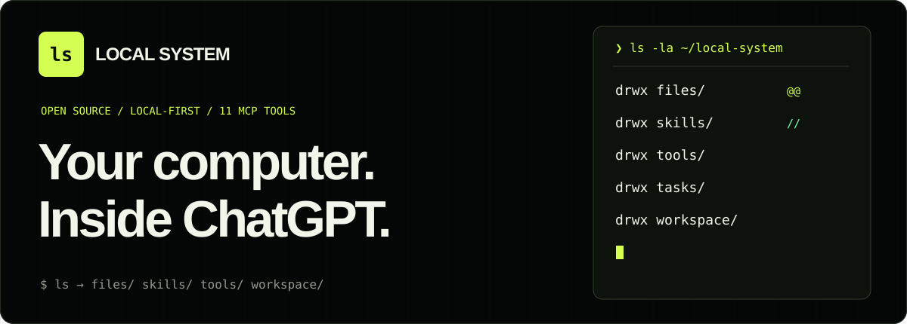
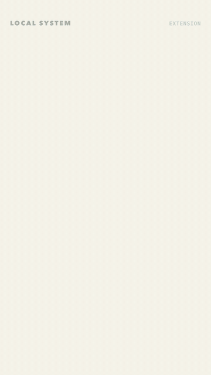

<p align="center">
  
</p>

<p align="center">
  
</p>

<div align="center">
  <p><strong>Open-source local tools, files and visual feedback for ChatGPT.</strong></p>
  <p>
    <a href="https://veer376.github.io/chatgpt-local-system/">Explore the website</a> &nbsp;·&nbsp;
    <a href="#get-started">Get started</a> &nbsp;·&nbsp;
    <a href="docs/INSTALL-SECURE-TUNNEL.md">Installation guide</a> &nbsp;·&nbsp;
    <a href="SECURITY.md">Security</a> &nbsp;·&nbsp;
    <a href="https://github.com/Veer376/chatgpt-local-system/issues">Issues</a>
  </p>
</div>

<p align="center">
  
</p>

<p align="center"><strong>32-second product demo · plays directly in the README</strong><br /><a href="assets/demo/local-system-demo.mp4">Open the full-quality MP4 ↗</a></p>

---

## See the work. Stay in control.

ChatGPT can do more than discuss your code: with Local System, it can inspect authorized project files, ask before classified destructive operations, and let you review or annotate its results without leaving the conversation.

<p align="center">
  
</p>

<table>
  <tr>
    <td width="50%" valign="top"><strong>Approval before risky operations</strong><br />Classified destructive commands request human confirmation by default. Other commands may still have side effects; the local bridge is <strong>not an OS sandbox</strong>.</td>
    <td width="50%" valign="top"><strong>Preview, annotate, iterate</strong><br />Review code, Markdown, sandboxed HTML, images, PDFs and video in the companion workspace. Send selected-text or timestamped feedback directly back to ChatGPT.</td>
  </tr>
  <tr>
    <td valign="top"><strong><code>//</code> Skills + <code>@@</code> Files</strong><br />Search and attach your registered <code>SKILL.md</code> instructions or actual authorized local project files from the ChatGPT composer.</td>
    <td valign="top"><strong>Project workspace + 11 MCP tools</strong><br />Browse files, open response paths, make patches, run commands and follow managed tasks through a fixed, inspectable local toolset.</td>
  </tr>
</table>

**Try the composer:** <code>//code-review</code> + <code>@@src/server.js</code> → “Review this file using the attached skill.”

<sub>The composer shortcuts, visual workspace and annotations require the companion Chrome extension. The MCP bridge can be used independently. Selected context and tool results may be sent to ChatGPT.</sub>

<p><a href="https://veer376.github.io/chatgpt-local-system/#playground"><strong>Try the interactive product playground →</strong></a> &nbsp;·&nbsp; <a href="extensions/local-system/README.md">Extension features and shortcuts →</a></p>

## Get started

### 1. Clone and install

You need **Node.js 20+**, npm, Git, and a supported ChatGPT account/workspace with custom MCP access. Chrome is required for the optional browser extension.

```bash
git clone https://github.com/Veer376/chatgpt-local-system.git
cd chatgpt-local-system
npm ci
```

### 2. Choose how ChatGPT connects

<table>
  <tr><th>Connection</th><th>Status and next step</th></tr>
  <tr>
    <td><strong><a href="docs/INSTALL-NGROK.md">ngrok / HTTPS</a></strong><br />Our goal: a simple sign-in and device-pairing setup.</td>
    <td><strong>Advanced only today.</strong> Requires an independently configured ChatGPT-compatible OAuth gateway. The automated OAuth connection is not yet built.<br /><a href="docs/INSTALL-NGROK.md">Understand ngrok and its security requirements →</a></td>
  </tr>
  <tr>
    <td><strong><a href="docs/INSTALL-SECURE-TUNNEL.md">OpenAI Secure MCP Tunnel</a></strong><br />No publicly reachable MCP URL.</td>
    <td><strong>Working setup path today.</strong> Requires OpenAI Platform tunnel access and the local tunnel client.<br /><a href="docs/INSTALL-SECURE-TUNNEL.md">Follow the installation guide →</a></td>
  </tr>
</table>

**Important:** Do not run `ngrok http 8765` and connect with “No authentication.” Local System can execute local commands. A public, anonymous endpoint would give others access. The [ngrok guide](docs/INSTALL-NGROK.md) explains the safe architecture without pretending it is one-click today.

### 3. Add the Chrome extension (optional)

The MCP bridge can work without it; the extension adds the file workspace, the `//` and `@@` pickers, previews, and annotations.

1. Open `chrome://extensions` in Chrome.
2. Turn on **Developer mode**, then select **Load unpacked**.
3. Select this repository's `extensions/local-system` folder.
4. Configure `LOCAL_EXTENSION_ORIGIN=chrome-extension://YOUR_EXTENSION_ID` for the running bridge. Reload the extension and refresh ChatGPT.

<p>
  <a href="https://developer.chrome.com/docs/extensions/get-started/tutorial/hello-world#load-unpacked">
    
  </a>
</p>
<sub>Screenshot: Google Chrome Developers. Click the image for the full installation guide—not an enlarged image file.</sub>

[Full extension configuration](extensions/local-system/README.md)

### 4. Run a read-only test

In ChatGPT, enable the Local System MCP connection and ask:

> Show my current project workspace and list the top-level files. Don't modify anything.

Then try typing `//` or `@@` in the composer with the Chrome extension enabled.

## How it works

```text
ChatGPT ── Secure MCP Tunnel / authorized HTTPS gateway ── Local System bridge
                                                               │
                                                     Local files and commands
                                                     Tasks, skills, approval
                                                               │
Chrome extension ───────── authenticated loopback API ─────────┘
       │
       └── // skills · @@ files · workspace · previews · annotations
```

The bridge exposes **11 MCP tools**: `bridge_context`, `workspace`, `display`, `view_image`, `apply_patch`, `execute_command`, `manage_task`, `request_user_input`, `write_todos`, `runtime_memory`, and `discover_skills`.

There is no required Local System cloud account. The extension is a client of the local Node.js server; it is **not** a standalone local filesystem server.

## Read this before giving it access

- **High authority:** local shell processes run with the privileges of the current OS account; workspace roots are not an OS-level sandbox.
- **Approval model:** classified destructive operations require approval by default. Other commands can still have side effects.
- **Network:** keep `/mcp` private unless you operate and verify an authenticated gateway. Never publicly expose the local `/local-ui/*`, `/local-file/*`, or `/local-image/*` endpoints.
- **Data sharing:** selected file attachments, skills, and tool outputs can be sent to ChatGPT.
- **Compatibility:** the extension depends on ChatGPT's evolving web interface; custom MCP availability varies by plan/workspace.

Read the [security model](SECURITY.md) and [operational notes](docs/OPERATIONS.md).

<details>
<summary><strong>Troubleshooting and more documentation</strong></summary>

| Problem | First check |
| --- | --- |
| MCP tools missing | Is the bridge ready at `http://127.0.0.1:8765/readyz`? Is your chosen tunnel running? |
| `//` or `@@` doesn't appear | Is the unpacked extension loaded and ChatGPT refreshed? Is the loopback bridge available? |
| File workspace empty | Does `LOCAL_EXTENSION_ORIGIN` match the installed Chrome extension ID? Are the project roots allowed? |
| Connection setup too complex | Start with the [Secure MCP Tunnel guide](docs/INSTALL-SECURE-TUNNEL.md); ngrok OAuth onboarding is still planned. |

[Existing technical reference](docs/TECHNICAL_REFERENCE.md) · [OpenAI custom MCP setup](https://developers.openai.com/api/docs/guides/custom-mcp-server) · [ngrok documentation](https://ngrok.com/docs/) · [Chrome extension setup](https://developer.chrome.com/docs/extensions/get-started/tutorial/hello-world#load-unpacked)

</details>

## Contributing

Issues, bug reproductions, accessibility improvements, and focused pull requests are welcome. Start with [CONTRIBUTING.md](CONTRIBUTING.md), the [support matrix](docs/SUPPORT.md), and [CHANGELOG.md](CHANGELOG.md). Security vulnerabilities must use the [private reporting process](SECURITY.md#reporting-a-vulnerability), not a public issue.

The biggest open product experience gap is easy, secure OAuth/device onboarding for ngrok. See the [technical reference](docs/TECHNICAL_REFERENCE.md) for internals and the [privacy/data-flow note](docs/PRIVACY.md) before connecting sensitive projects.

**License:** [MIT](LICENSE). Local System is an independent project, not an official OpenAI or ngrok product.
