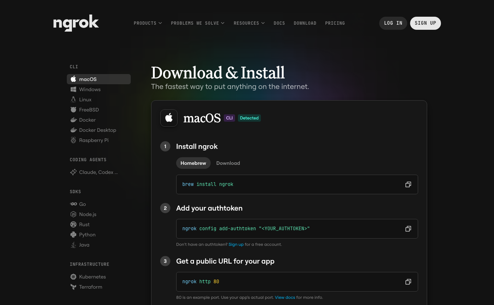

# ngrok setup for Local System

> **Read this before starting a public tunnel.** We want ngrok to be the easiest path eventually. Today, however, **ngrok only supplies HTTPS transport**. The Local System public endpoint must also enforce **ChatGPT-compatible OAuth authorization** before local commands and file tools are available. That managed sign-in and device-pairing flow is not implemented in this repository.

[← README](../README.md) · [Working private setup](INSTALL-SECURE-TUNNEL.md) · [ngrok docs](https://ngrok.com/docs/) · [ChatGPT MCP authentication](https://developers.openai.com/plugins/build/auth)



## The future setup (not available yet)

```text
Install Local System
       ↓
Sign in and approve this computer
       ↓
Local System manages the secure connection
       ↓
Install and authorize the ChatGPT plugin
       ↓
ChatGPT can access only the approved computer and folders
```

To make that possible for ordinary users, Local System still needs a managed identity/authorization service, a per-device session and revocation model, and routing for connected devices. We cannot deliver it merely by embedding an ngrok authtoken in the open-source app.

## What can you do today?

| Method | Status |
| --- | --- |
| **OpenAI Secure MCP Tunnel** | [Supported private setup](INSTALL-SECURE-TUNNEL.md), with working configuration scripts and no public MCP URL. |
| **ngrok + an OAuth-aware MCP gateway you operate** | Possible for experienced developers **with their own independently configured gateway**; not plug-and-play. |
| `ngrok http 8765` + **No authentication** in ChatGPT | **Unsafe. Never use this method.** |

**Why the extra OAuth component?** ChatGPT custom MCP connections use the authorization protocol to link an end user and issue scoped tokens. ngrok's optional browser OAuth login/traffic policy does not automatically turn Local System into an MCP OAuth 2.1 resource server. ChatGPT does not offer a general-purpose “paste your own secret bearer header” field in its normal custom-MCP setup.

## 1. Create your own ngrok account (preparation only)

1. Open [ngrok sign-up](https://dashboard.ngrok.com/signup) and create an account.
2. Open the [ngrok setup/download page](https://ngrok.com/download). Choose [macOS](https://ngrok.com/download/mac-os), [Windows](https://ngrok.com/download/windows) or [Linux](https://ngrok.com/download/linux).
3. Install the CLI using the official platform instructions. On macOS with Homebrew:

```bash
brew install ngrok
ngrok version
```

4. Find **Your Authtoken** in your ngrok dashboard, then add it to **your own local installation** following the official dashboard's command.

Do not put your ngrok authtoken, domain reservation credentials, or OAuth secrets into a committed file or screenshot. Users should **never receive the maintainer's personal ngrok authtoken**. ngrok might require additional verification or account limits depending on the plan.

**Stop here unless you already have a secured MCP gateway.** Completing ngrok installation alone does **not** make it safe to publish Local System.

## 2. For advanced developers: what the secured architecture requires

```text
ChatGPT
   │  Authorization: Bearer <OAuth access token>
   ▼
Your HTTPS ngrok endpoint
   │  Route only MCP + OAuth discovery paths
   ▼
Your OAuth-aware MCP gateway  ──→ token validation, issuer/audience/scopes,
   │                             per-user device authorization, revocation
   ▼
http://127.0.0.1:8765/mcp
   │
Local System bridge → local files and commands
```

**Requirements before starting a public ngrok endpoint:**

- ChatGPT-compatible OAuth 2.1 authorization-code flow with PKCE, resource discovery (e.g. `/.well-known/oauth-protected-resource`), and relevant authorization-server metadata or valid alternatives.
- Gateway rejects unauthenticated/wrong-user/expired/wrong-scope requests; machine authorization is checked independently of login.
- Routing allows only `/mcp` and the exact required OAuth discovery/callback paths. **Do not expose** `/local-ui/*`, `/local-file/*`, `/local-image/*`, the local extension session issuer, or the tunnel-client admin listener.
- Local System binds to loopback, uses a restricted test workspace, requires destructive-operation approval, and does not expose the gateway's internal port to the local network.
- The external gateway uses TLS, protects secrets, and handles disconnected devices, access-token revocation, logging, and failure safely.

See [ChatGPT's official authentication contract](https://developers.openai.com/plugins/build/auth) and [ngrok Traffic Policy documentation](https://ngrok.com/docs/traffic-policy/) for the actual integration requirements.

### After you already have such a gateway

Have your OAuth gateway listen on a *separate loopback port*, for example `127.0.0.1:9443`. The following example exposes **that authenticated gateway**, **not Local System's port 8765**:

```bash
# Example only: requires an independently implemented, tested OAuth-aware gateway
ngrok http 127.0.0.1:9443
```

The printed ngrok HTTPS hostname becomes the public origin. Copy its **`https://…/mcp`** URL into [ChatGPT Plugins](https://chatgpt.com/plugins) → **Add custom MCP server** → **Server URL**. Select **OAuth** and complete the authorization flow. Use the URL only after its identity checks and route restrictions pass.

**Important:** Local System currently does **not** ship the example OAuth gateway or this example 9443 listener. Don't run the command unless you set it up yourself.

## 3. Verify that authentication is actually enforced

Before connecting ChatGPT, send an **unauthenticated** initialize request from outside your local machine against the public `/mcp` endpoint:

```bash
curl -i 'https://YOUR_NGROK_HOST/mcp' \
  -H 'content-type: application/json' \
  -H 'accept: application/json, text/event-stream' \
  --data '{"jsonrpc":"2.0","id":1,"method":"initialize","params":{"protocolVersion":"2025-03-26","capabilities":{},"clientInfo":{"name":"auth-check","version":"1"}}}'
```

It **must not return 200 with MCP tool access**. Expect an authentication challenge (usually HTTP 401 with relevant OAuth metadata) or explicit denial. Validate signed-in requests, revoked tokens, incorrect device access, and blocked `/local-ui/auth/session` paths as well. **A successful 401 check alone is not a complete security audit.**

In the past, an unauthenticated test reached an active `/mcp` endpoint. That tunnel was intentionally shut down before the project's first public GitHub release; this guide is designed to prevent repeating that condition.

## 4. When something fails

| Problem | Next action |
| --- | --- |
| No ChatGPT sign-in UI | MCP OAuth discovery/metadata or resource challenge may be incomplete. |
| Tool scan returns 401 | Confirm the OAuth flow completed and an appropriate access token reaches the gateway. |
| Tool scan returns 200 without login | **Stop the tunnel immediately** and investigate unauthorized access. |
| ngrok URL changes | Update the custom MCP server URL; stable domains depend on ngrok configuration. |
| Chrome extension file tree fails | That uses the **local** bridge and its extension session, not the public OAuth endpoint. |
| Want fewer steps today | Use the [private Secure MCP Tunnel guide](INSTALL-SECURE-TUNNEL.md) instead. |

## Official references

[ngrok download](https://ngrok.com/download) · [ngrok authentication/traffic policies](https://ngrok.com/docs/traffic-policy/) · [MCP OAuth in ChatGPT](https://developers.openai.com/plugins/build/auth) · [ChatGPT custom MCP server](https://developers.openai.com/api/docs/guides/custom-mcp-server)
